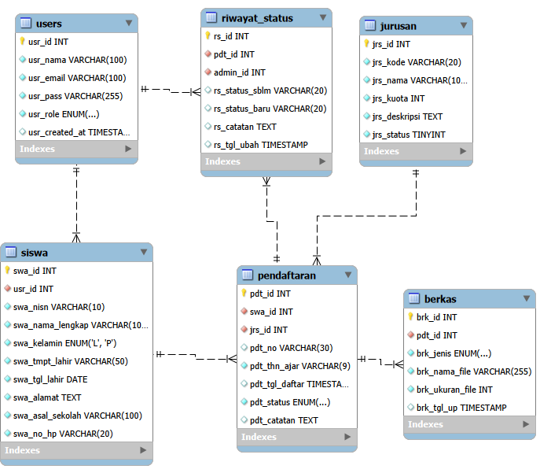

# Tugas ke 7 - Database PPDB SMK NUSANTARA

## Deskripsi

Membuat database dengan mySQL. Terdapat 6 tabel sesuai dengan PRD:

| No. | Tabel          | Fungsi                                      |
| :-- | :------------- | :------------------------------------------ |
| 1   | users          | Menyimpan akun pengguna.                    |
| 2   | siswa          | Menyimpan biodata calon siswa.              |
| 3   | jurusan        | Menyimpan data jurusan.                     |
| 4   | pendaftaran    | Menyimpan transaksi pendaftaran dan status. |
| 5   | berkas         | Menyimpan metadata dokumen.                 |
| 6   | riwayat_status | Menyimpan riwayat perubahan status.         |

### Relasi Tabel

- Users 1:1 Siswa.
- Siswa 1:N Pendaftaran.
- Jurusan 1:N Pendaftaran.
- Pendaftaran 1:N Berkas.
- Pendaftaran 1:N Riwayat_Status.
- Users (Admin) 1:N Riwayat_Status.
   

PRD diupload bersama dengan source code.

Menambahkan user "admin".

## Screenshot

## Source Code

- https://github.com/putupradiptaananda/ppdb-online-smk-n

## Alaman URL Website

`-`
