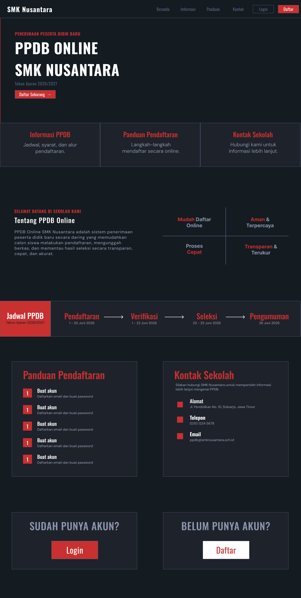
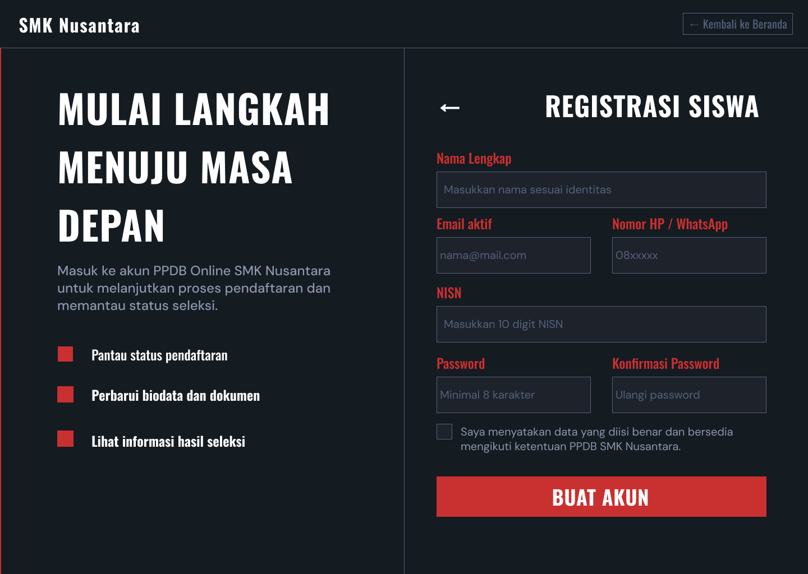

# Tugas ke 8 - Autentikasi PPDB SMK NUSANTARA

## Deskripsi

Frontend berupa landing page, login page, dan register page. Backend berupa registrasi dan login.

Input registrasi dan tabel yang berhubungan:

| No. | Input        | Tabel        |
| :-- | :----------- | :----------- |
| 1   | Nama lengkap | users, siswa |
| 2   | Email aktif  | users        |
| 3   | No. HP       | siswa        |
| 4   | NISN         | siswa        |
| 5   | Password     | users        |

Secara default, `usr_role` diisi dengan `siswa`.

Login hanya menggunakan email dan password.

### Pemenuhan Kebutuhan (PRD Checklist)

#### 1. Kebutuhan Fungsional (Functional Requirements)

| ID         | Fitur           | Status | Catatan                                                               |
| :--------- | :-------------- | :----- | :-------------------------------------------------------------------- |
| **FR-001** | Registrasi Akun | [x]    | Memvalidasi email unik, 10 digit NISN, hash password, insert 2 tabel. |
| **FR-002** | Login           | [x]    | Verifikasi email/password, session setup, role check.                 |
| **FR-003** | Logout          | [x]    | Sesi dihancurkan, kembali ke landing page.                            |

#### 2. Kebutuhan Non-Fungsional (Non-Functional Requirements)

| Kategori           | Status | Keterangan                                                                  |
| :----------------- | :----- | :-------------------------------------------------------------------------- |
| **Security**       | [x]    | Menggunakan `password_hash()` dan `password_verify()`.                      |
| **SQL Security**   | [x]    | Menggunakan **PDO Prepared Statements** untuk mencegah SQL Injection.       |
| **Data Integrity** | [x]    | Menggunakan **Database Transactions** (Begin/Commit/Rollback).              |
| **Validation**     | [x]    | Validasi di sisi server (PHP) untuk NISN (10 digit) dan password (8+ char). |

---

## Status Implementasi

- [x] Database Configuration (PDO)
- [x] Register (`auth/register.php`)
- [x] Login (`auth/login.php`)
- [x] Logout (`auth/logout.php`)

_Saat ini belum ada fitur dashboard, maka sebagai pengganti, untuk testing, login yang berhasil akan menampilkan alert._

## Sumber referensi/web asli

- Referensi UI : https://sman4dps.sch.id/

## Screenshot

- Landing page
  

- Register page
  

- Login page, registrasi berhasil
  

- Login berhasil
  

## Desain UI

- Landing page design
  

- Register page design
  

## Source Code

- https://github.com/putupradiptaananda/ppdb-online-smk-n

## Alaman URL Website

- `-`
